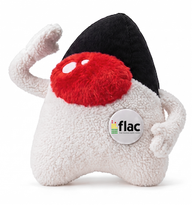

[](https://jitpack.io/#umjammer/vavi-sound-flac-nayuki)
[](https://github.com/umjammer/vavi-sound-flac-nayuki/actions/workflows/maven.yml)
[](https://github.com/umjammer/vavi-sound-flac-nayuki/actions/workflows/codeql.yml)

[](https://github.com/umjammer/vavi-sound-sandbox)

# vavi-sound-flac-nayuki



Pure Java FLAC decoder (Java Sound SPI) powered by [FLAC-library-Java](https://github.com/nayuki/FLAC-library-Java)

## Install

 * https://jitpack.io/#umjammer/vavi-sound-flac-nayuki

## Usage

```java
    AudioInputStream ais = AudioSystem.getAudioInputStream(Paths.get(flac).toFile());
    Clip clip = AudioSystem.getClip();
    clip.open(AudioSystem.getAudioInputStream(new AudioFormat(44100, 16, 2, true, false), ais));
    clip.loop(Clip.LOOP_CONTINUOUSLY);
```

## References


## TODO

 * ~~java sound spi~~

---

<sub>image designed by @umjammer, drawn by nano banana</sub>
